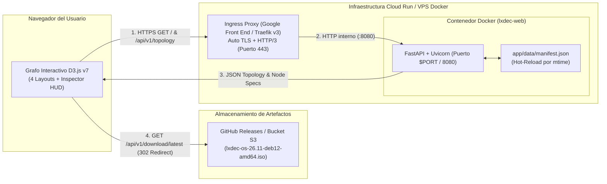

# LXDEC OS (`26.11-deb13`) — Interactive System & Data Topology Portal

> **LXDEC OS** es una distribución Linux derivada independiente basada en **Debian 13 (Trixie Stable)** con Kernel **6.12 LTS**, diseñada específicamente para **Ingenieros de Datos, Administradores de Bases de Datos (DBAs) y Desarrolladores Backend**.
>
> Portal en vivo: **[https://lxdec.org](https://lxdec.org)**

Este repositorio contiene el **Portal Web Interactivo de Arquitectura y Distribución** de **LXDEC OS**, construido con **FastAPI (Python 3.12)** en el backend y un motor de visualización de grafos en **D3.js v7** en el frontend, empaquetado en **Docker** para despliegue tanto Serverless (Google Cloud Run / Render / Koyeb) como en VPS (OCI / Hetzner con Traefik).

---

## 1. Decisiones Arquitectónicas de la Distribución (`LXDEC OS`)

### 1.1. Política de Paquetes 100% Nativos (Cero Mantenimiento Frágil)
Para garantizar estabilidad empresarial, actualizaciones de seguridad desatendidas (`apt` / `nala`) y evitar paquetes huérfanos o compilaciones manuales (`.tar.bz2`), **LXDEC OS** se rige por tres principios:
1. **Base Debian 12 (`bookworm`) Estable:** `glibc` inmutable (vital para evitar corrupción silenciosa de índices B-Tree por cambios de *collation*), kernel `6.1 LTS` / `6.11-bpo` con perfiles `/etc/sysctl.d/99-lxdec.conf` y gestor transaccional **`Nala`** con descargas paralelas y rollback (`nala history undo`).
2. **Construcción Reproducible (`live-build` + `Calamares`):** La imagen ISO híbrida se compila declarativamente con Debian `live-build` e incluye el instalador gráfico **Calamares** con perfiles de particionado **XFS** (optimizado para WAL y Direct I/O) y **OpenZFS** (compresión LZ4/ZSTD para cargas analíticas).
3. **Ecosistema Python/OLAP Aislado (`pipx` + `venv` + `direnv`):** Las librerías C++/Cython pesadas (`python3-pyarrow`, `python3-numpy`, `python3-pandas`) provienen de APT, mientras que herramientas de usuario como `duckdb`, `dbt-postgres` o `sqlfluff` se gestionan de forma aislada vía `pipx` sin contaminar las librerías del sistema operativo.

### 1.2. Estrategia "Multi-Paradigm PostgreSQL" (Official PGDG)
En lugar de fragmentar la memoria RAM y operar múltiples motores con licencias restrictivas (como SSPL), **LXDEC OS** integra de fábrica el repositorio oficial **PGDG (`apt.postgresql.org`)** junto con `postgresql-common` de Debian para convertir a **PostgreSQL (16 / 17)** en un motor multiparadigma único:

| Paradigma de Datos | Implementación en LXDEC OS (APT / PGDG) | Reemplaza a |
| :--- | :--- | :--- |
| **Relacional & HA (OLTP)** | `postgresql-16`, `postgresql-17`, `pgbouncer`, `patroni`, `pgbackrest`, `postgresql-17-repack` | Motores RDBMS propietarios |
| **Grafos (OpenCypher)** | **`Apache AGE`** (`postgresql-16-age`) — consultas híbridas SQL + Cypher `MATCH (a)-[r]->(b)` | Neo4j |
| **Documental (NoSQL)** | **`JSONB` nativo** + índices invertidos `GIN` + `SQL/JSON Path` + compresión `TOAST` + `jq` | MongoDB (sin licencia SSPL) |
| **Vectorial & IA** | **`pgvector`** (`postgresql-17-pgvector`) — índices HNSW / IVFFlat para embeddings y RAG | Bases vectoriales dedicadas |
| **Geoespacial & Series** | **`PostGIS 3`** (`postgresql-17-postgis-3`) + **`pg_partman`** (`postgresql-17-partman`) + `pg_cron` | Motores GIS / Time-Series separados |
| **Federación & Caché** | **`tds_fdw`** (conexión directa a MS SQL Server), `postgres_fdw` + **`Redis`** (`redis-server`) y **`SQLite3`** | ETLs complejos punto a punto |

---

## 2. Arquitectura del Portal Web y Flujo de Red

El portal está diseñado bajo un modelo **Stateless Container** con recarga dinámica del manifiesto en disco y **Offloading de Ancho de Banda (`HTTP 302`)** para la descarga de la imagen ISO.



---

## 3. Catálogo de Nodos y Capas del Grafo (`manifest.json`)

El grafo modela **14 subsistemas (nodos)** y **31 interconexiones técnicas (enlaces)** distribuidos en **5 capas arquitectónicas**:

1. **Core System & Kernel (`#38bdf8`):**
   * `lxdec-core`: Kernel Debian 12 (`linux-image-amd64 systemd-sysv procps`) + perfiles `sysctl` (`vm.swappiness=1`, `TCP BBR`, `Transparent HugePages madvise`).
   * `zfs-xfs-storage`: `xfsprogs zfsutils-linux btrfs-progs lvm2`.
   * `apt-vendor-repos`: `apt nala postgresql-common ca-certificates gnupg`.
2. **Multi-Paradigm PostgreSQL & DBA (`#a855f7`):**
   * `postgresql-suite`: Clústeres simultáneos PGDG (`postgresql-16 postgresql-17 pgbouncer pgbackrest patroni`).
   * `pg-multiparadigm`: Extensiones de Grafos Cypher, Vectores, GIS y Particiones (`postgresql-16-age postgresql-17-pgvector postgresql-17-postgis-3 postgresql-17-partman`).
   * `redis-valkey`: Caché en memoria y motor embebido (`redis-server redis-tools sqlite3 sqlite3-tools`).
   * `dba-diagnostics`: Clientes interactivos, federación FDW y benchmarking (`pgcli pspg pgbadger pgtop postgresql-17-tds-fdw unixodbc odbc-postgresql sysbench`).
3. **Data Engineering & OLAP (`#22c55e`):**
   * `duckdb-polars`: Procesamiento columnar en memoria (`python3-pyarrow python3-pandas python3-numpy python3-venv pipx`).
   * `kafka-redpanda`: Streaming de eventos y CDC con `wal2json` (`kafkacat librdkafka-dev python3-confluent-kafka`).
   * `orchestration-elt`: Pipelines reproducibles y transformación JSON (`pipx direnv jq yq git tmux`).
4. **Backend & Runtime Stack (`#f59e0b`):**
   * `backend-runtimes`: Compiladores nativos y enlazado ultrarrápido (`python3-full python3-fastapi python3-uvicorn python3-psycopg2 python3-sqlalchemy rustc cargo golang-go clang mold`).
   * `api-networking`: Balanceo TCP para réplicas Postgres y pruebas de estrés (`httpie curl wrk protobuf-compiler haproxy nginx`).
5. **Observability & Containers (`#ec4899`):**
   * `containers-iac`: Contenedores rootless y automatización (`podman buildah skopeo docker.io docker-compose ansible`).
   * `ebpf-telemetry`: Diagnóstico de kernel y latencia I/O de disco (`bpfcc-tools bpftrace linux-perf btop iotop-c htop sysstat`).

---

## 4. Plantillas Interactivas del Grafo (D3.js v7 Layouts)

El frontend permite alternar en tiempo real entre **4 plantillas de visualización** con guías arquitectónicas dibujadas en SVG:

* **`✦ Force` (Física Orgánica):** Simulación dirigida por fuerzas (`d3.forceManyBody` + `d3.forceLink`) para exploración libre y arrastre (*drag & pin*).
* **`◎ Concéntrico` (Anillos del Sistema / OS Rings):** Organiza los subsistemas en 3 anillos concéntricos alrededor del Kernel (`RING 0: Kernel` $\rightarrow$ `RING 1: Storage, APT & eBPF` $\rightarrow$ `RING 2: Multi-Paradigm PostgreSQL` $\rightarrow$ `RING 3: Data Eng, Runtimes & Containers`).
* **`☰ Jerárquico` (Arquitectura por Capas / Stack Tiers):** Disposición horizontal en 4 niveles de abstracción, desde la base del sistema operativo (`Layer 1`) hasta los runtimes de aplicación y contenedores (`Layer 4`).
* **`❖ Clústeres` (Islas Gravitacionales por Rol):** Agrupa los nodos en 5 regiones visuales identificadas por color para cada especialidad técnica.

---

## 5. Estructura del Repositorio

```text
lxdec/
├── Dockerfile                  # Imagen Python 3.12-slim sin privilegios (USER lxdec, puerto $PORT)
├── docker-compose.yml          # Orquestación local (:8080 con hot-reload) + Perfil opcional Traefik VPS
├── requirements.txt            # Dependencias: FastAPI, Uvicorn, Pydantic-Settings, HTTPX
├── .env.example                # Variables de entorno (versión 26.11-deb12, URL ISO, SHA-256)
├── .dockerignore
├── .gitignore
├── README.md
└── app/
    ├── main.py                 # Aplicación FastAPI, montaje de estáticos y /healthz
    ├── core/
    │   └── config.py           # Configuración tipada con Pydantic
    ├── api/
    │   └── routes.py           # Endpoints REST + recarga automática de manifest.json por mtime
    ├── data/
    │   └── manifest.json       # Definición declarativa de los 14 nodos, 31 enlaces y paquetes APT
    └── static/
        ├── index.html          # HUD principal, selector de layouts, inspector lateral y modal ISO
        ├── css/
        │   └── styles.css      # Tema oscuro técnico, estilos SVG y guías de arquitectura
        └── js/
            └── app.js          # Motor D3.js v7 con las 4 plantillas de grafo, filtros y búsqueda
```

---

## 6. Guía de Ejecución y Despliegue

### 6.1. Desarrollo y Pruebas en Local
Con **Docker Compose** (incluye volumen `./app:/workspace/app:ro` para reflejar cambios en `manifest.json` y `static/` al instante):
```bash
docker compose up -d --build
```
O directamente con **Python / Uvicorn**:
```bash
python3 -m venv .venv
source .venv/bin/activate
pip install -r requirements.txt
uvicorn app.main:app --reload --port 8080
```
* **Portal Interactivo D3.js:** `http://localhost:8080`
* **Documentación OpenAPI (Swagger):** `http://localhost:8080/docs`

### 6.2. Despliegue en un VPS (ej. OCI Always Free `VM.Standard.E2.1.Micro` o ARM `A1.Flex`)
Activando el perfil `vps`, Docker Compose levanta automáticamente **Traefik v3** en los puertos `80` y `443` con emisión automática de certificados SSL Let's Encrypt:
```bash
cp .env.example .env
# Edita DOMAIN y ACME_EMAIL en .env
mkdir -p traefik && touch traefik/acme.json && chmod 600 traefik/acme.json
docker compose --profile vps up -d --build
```

### 6.3. Despliegue Serverless (Google Cloud Run / Render / Koyeb)
El `Dockerfile` en la raíz escucha automáticamente en la variable `$PORT` (`8080`):
```bash
gcloud run deploy lxdec-web \
  --source . \
  --region us-central1 \
  --allow-unauthenticated \
  --port 8080 \
  --memory 256Mi \
  --cpu 1 \
  --min-instances 0 \
  --max-instances 2
```

---

## 7. Referencia de Endpoints de la API

| Método | Ruta | Descripción |
| :--- | :--- | :--- |
| `GET` | `/` | Sirve la aplicación interactiva con el grafo D3.js v7. |
| `GET` | `/api/v1/topology` | Devuelve metadatos, categorías, nodos y enlaces. Acepta `?category=core\|dba\|data_eng\|backend\|observability`. |
| `GET` | `/api/v1/node/{node_id}` | Devuelve el detalle técnico, paquetes APT y vecinos conectados de un nodo específico. |
| `GET` | `/api/v1/release` | Devuelve versión (`26.11-deb12`), kernel, tamaño y hash SHA-256 de la ISO actual. |
| `GET` | `/api/v1/download/latest` | Ejecuta un `HTTP 302 Redirect` hacia el almacenamiento externo (GitHub Releases / S3). |
| `GET` | `/healthz` | Verificación de estado para contenedores y balanceadores de carga. |

---

## 8. Aviso Legal y de Marca Registrada (Trademark Notice)

**LXDEC OS** es una distribución derivada independiente basada en **Debian GNU/Linux**. No está afiliada, patrocinada ni respaldada oficialmente por *Software in the Public Interest, Inc. (SPI)* ni por el *Proyecto Debian*. *Debian* es una marca registrada de *Software in the Public Interest, Inc.*
